# Videos de REGB ERP

Grabados con la app real (modo demo, con datos ficticios) y montados con Hyperframes.
Cada video viene en dos formatos: **horizontal** 1920×1080, para escritorio y web, y
**vertical** 1080×1920, para Reels, TikTok y Stories. Van a 30 fps y duran entre
23 y 25 s.

## Presentación general

[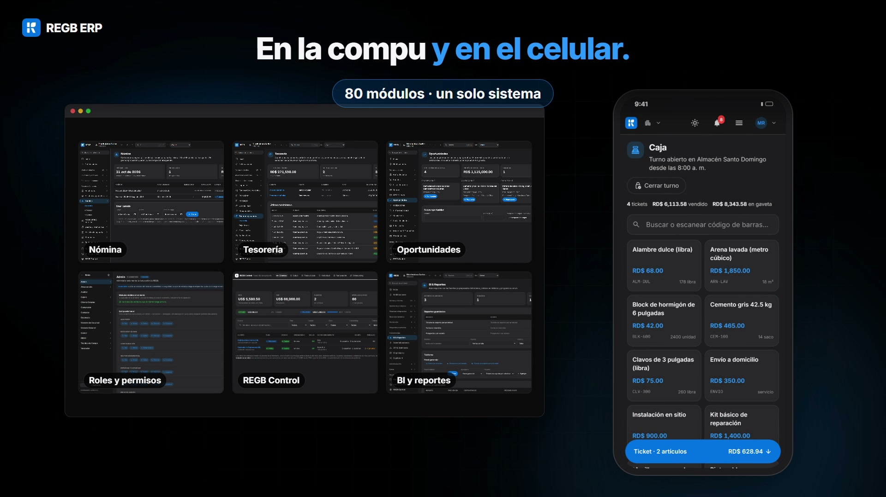](regb-erp-horizontal.mp4)

[Horizontal](regb-erp-horizontal.mp4) · [Vertical](regb-erp-vertical.mp4)

## Serie por área

| | Video |
|---|---|
| [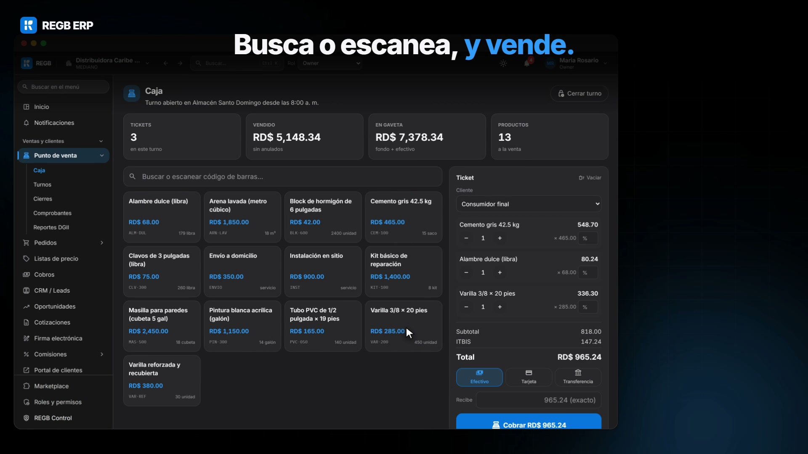](serie/caja/regb-caja-horizontal.mp4) | **Punto de venta** La caja de tu negocio. La caja de REGB ERP: escaneas, cobras y cada venta sale con su NCF. Al cerrar el turno cuentas la gaveta antes de ver lo esperado, y el 606/607 queda listo para la DGII. [Horizontal](serie/caja/regb-caja-horizontal.mp4) · [Vertical](serie/caja/regb-caja-vertical.mp4) |
| [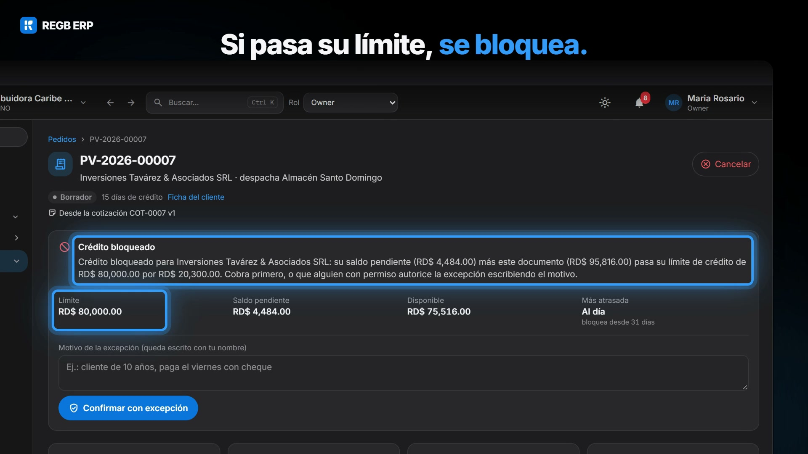](serie/ventas-credito/regb-ventas-credito-horizontal.mp4) | **Ventas a crédito** Vende a crédito, y&nbsp;cobra. En REGB ERP la cotización que el cliente aprueba se vuelve pedido con un clic, y si ese pedido pasa su límite de crédito, el crédito se bloquea solo. La cartera por antigüedad te dice quién te debe y desde cuándo, y cuando registras el cobro tu cliente ve la factura «Pagada» en su portal. [Horizontal](serie/ventas-credito/regb-ventas-credito-horizontal.mp4) · [Vertical](serie/ventas-credito/regb-ventas-credito-vertical.mp4) |
| [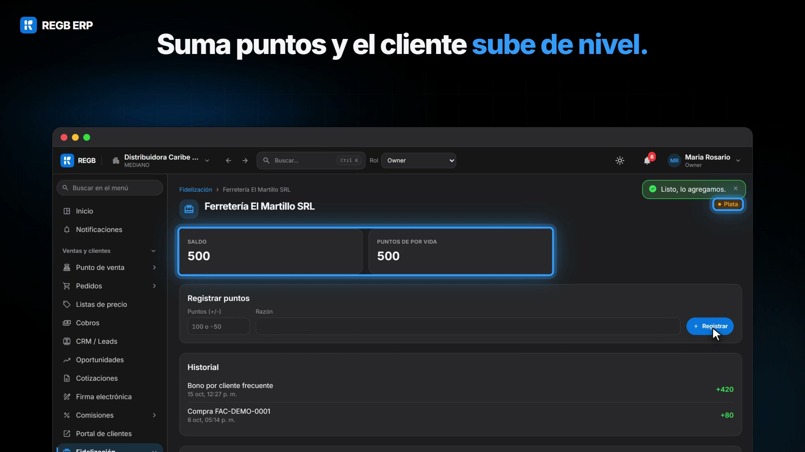](serie/crm/regb-crm-horizontal.mp4) | **CRM y ventas** Del prospecto al cliente fiel. Del prospecto al cliente fiel en REGB ERP: los prospectos se reparten por turno con su puntaje, la oportunidad que avanza de etapa ajusta sola el pronóstico ponderado y el cliente que suma puntos pasa de Bronce a Plata.
Y en Comisiones ninguna se paga sin aprobar; el vendedor ve las suyas en «Mis comisiones». [Horizontal](serie/crm/regb-crm-horizontal.mp4) · [Vertical](serie/crm/regb-crm-vertical.mp4) |
| [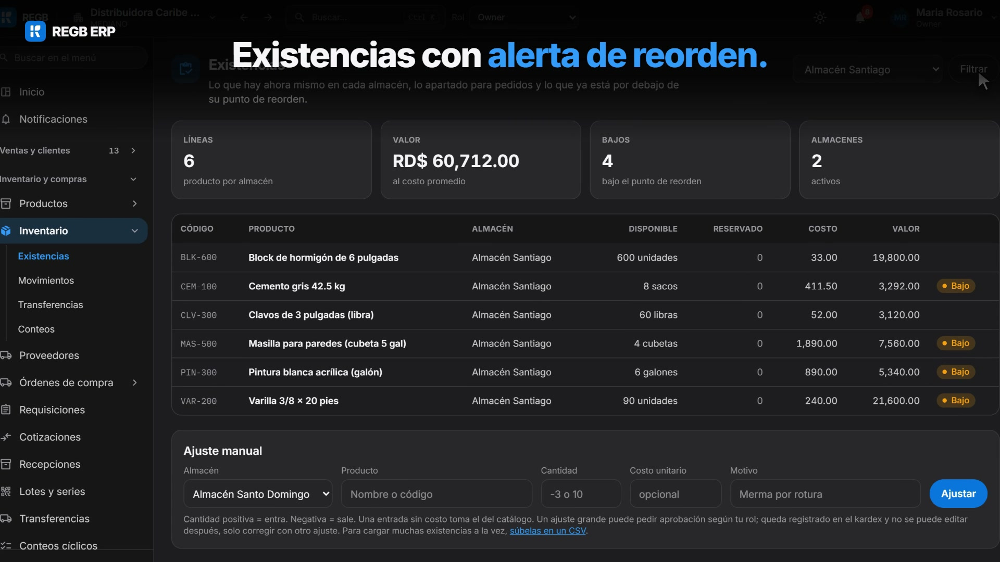](serie/inventario/regb-inventario-horizontal.mp4) | **Inventario** Tu inventario, por almacén. El inventario de REGB ERP, almacén por almacén: existencias con alerta de punto de reorden, transferencias que marcan lo que faltó al recibir y conteos cíclicos a ciegas que no ajustan nada sin aprobación. Y cada producto con su código de barras para escanear e imprimir etiquetas. [Horizontal](serie/inventario/regb-inventario-horizontal.mp4) · [Vertical](serie/inventario/regb-inventario-vertical.mp4) |
| [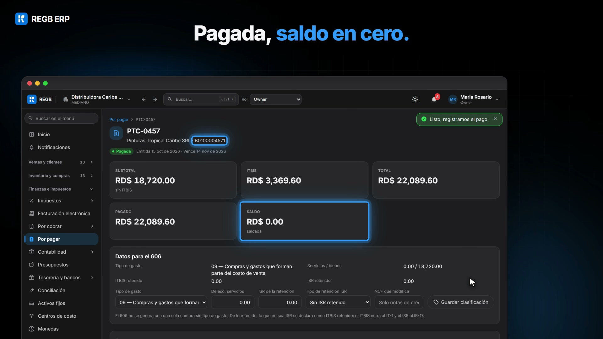](serie/compras/regb-compras-horizontal.mp4) | **Compras y pagos** De la requisición al pago. En REGB ERP la compra va de punta a punta: la requisición la aprueba quien tiene el límite de monto en su rol, la orden se recibe aunque llegue incompleta y lo aceptado entra al kardex, y la factura del proveedor, con su NCF, se paga hasta dejar el saldo en cero. Los gastos que reporta el equipo también se aprueban ahí mismo. [Horizontal](serie/compras/regb-compras-horizontal.mp4) · [Vertical](serie/compras/regb-compras-vertical.mp4) |
| [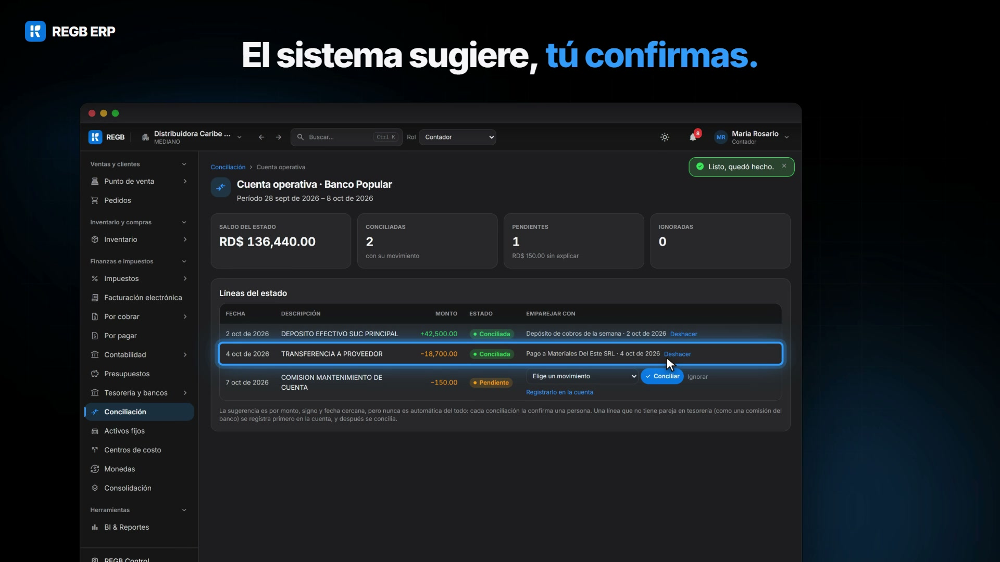](serie/contabilidad/regb-contabilidad-horizontal.mp4) | **Contabilidad y tesorería** Los asientos salen solos. En REGB ERP las ventas, cobros, compras y pagos se contabilizan solos: cada asiento nace cuadrado y la balanza de comprobación cuadra. En la conciliación bancaria el sistema sugiere y tú confirmas, y el flujo de caja se proyecta ocho semanas hacia adelante. [Horizontal](serie/contabilidad/regb-contabilidad-horizontal.mp4) · [Vertical](serie/contabilidad/regb-contabilidad-vertical.mp4) |
| [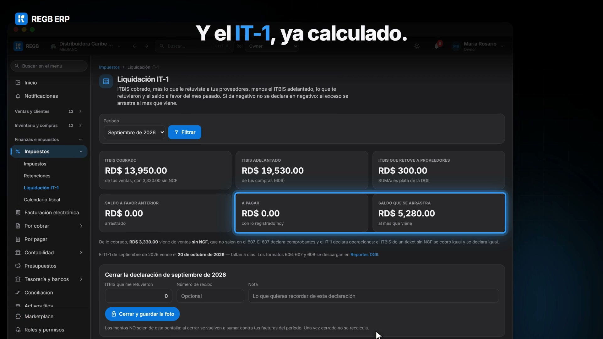](serie/dgii/regb-dgii-horizontal.mp4) | **Impuestos y DGII** Tu mes con la DGII. Cuántos NCF te quedan y cuándo vencen, el 606, 607 y 608 de cada mes y el IT-1 ya calculado con tus ventas y compras: así lleva REGB ERP el mes fiscal de una pyme dominicana. Lo que vas a declarar se revisa en pantalla y se baja en CSV; el e-CF todavía está en camino. [Horizontal](serie/dgii/regb-dgii-horizontal.mp4) · [Vertical](serie/dgii/regb-dgii-vertical.mp4) |
| [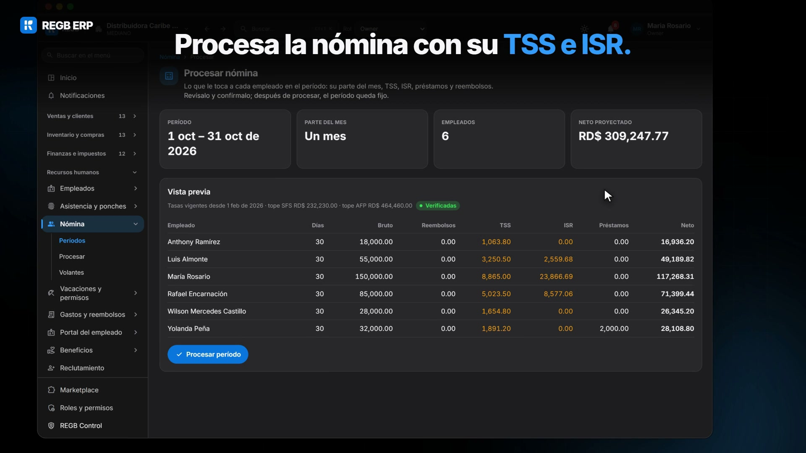](serie/personas/regb-personas-horizontal.mp4) | **Recursos humanos** Tu gente, en orden. REGB ERP procesa la nómina con su TSS e ISR y deja el volante de cada empleado en su portal, también en el celular. Las vacaciones se piden ahí mismo y RRHH las aprueba, y cada ponche se valida con la geocerca de su sucursal. [Horizontal](serie/personas/regb-personas-horizontal.mp4) · [Vertical](serie/personas/regb-personas-vertical.mp4) |
| [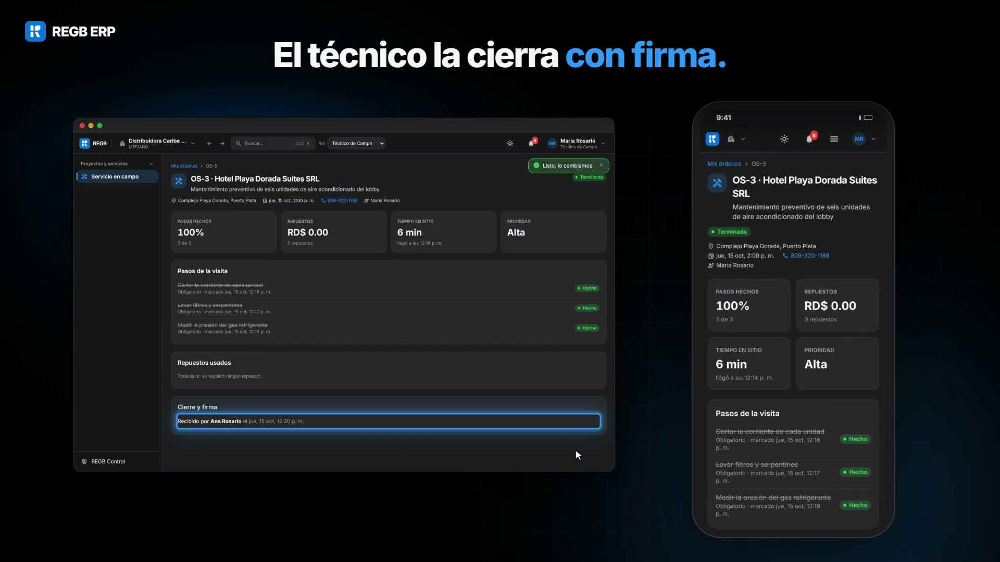](serie/operacion/regb-operacion-horizontal.mp4) | **Operación** De la planta al cliente. De la planta al cliente en REGB ERP: liberas la orden de producción y salen sus componentes, una inspección con un criterio crítico fallido queda reprobada y el equipo al que ya le toca servicio recibe su orden de trabajo. Y el técnico cierra la visita desde el celular, con la firma de quien recibe. [Horizontal](serie/operacion/regb-operacion-horizontal.mp4) · [Vertical](serie/operacion/regb-operacion-vertical.mp4) |
| [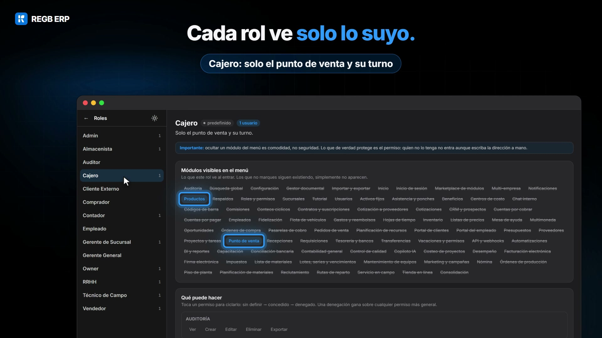](serie/plataforma/regb-plataforma-horizontal.mp4) | **Plataforma** La plataforma que lo une todo. En REGB ERP enciendes solo los módulos que usas y el simulador te dice cuánto sumarían a tu factura antes de pedirlos. Cada rol ve solo lo suyo —el cajero, el punto de venta y su turno— y la bitácora guarda cada cambio con su antes y su después. [Horizontal](serie/plataforma/regb-plataforma-horizontal.mp4) · [Vertical](serie/plataforma/regb-plataforma-vertical.mp4) |

La música es la serie «Happy Beats / Business Moves» de [ende.app](https://ende.app/en) y los efectos de sonido son de [Kenney](https://kenney.nl/).
Antes de publicar los videos fuera del repo, confirma la licencia de la música.
